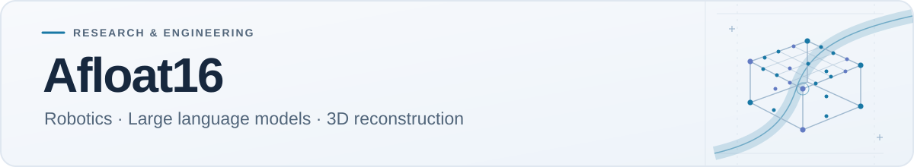

<picture>
  <source media="(prefers-color-scheme: dark)" srcset="https://raw.githubusercontent.com/Afloat16/Afloat16/main/assets/banner-2026-10-30-dark.svg?v=2">
  
</picture>

**My research focuses on robotics, large language models, and 3D reconstruction.**

I build reproducible research tools, explore native software protection, and contribute focused upstream fixes.

Python · TypeScript · C/C++ · Reproducible experiments · Upstream engineering

[My projects](#projects-i-build) · [Upstream contributions](#open-source-contributions) · [简体中文](README.zh-CN.md)

## Open-source contributions

**142 verified merged author PRs across 31 upstream repositories**, spanning robotics, machine learning, geometry and developer tools. Snapshot: **6 November 2026 · 11:10 CST (UTC+8)**.

<picture>
  <source media="(prefers-color-scheme: dark)" srcset="https://raw.githubusercontent.com/Afloat16/Afloat16/main/assets/stats-2026-11-06-1110-dark.svg?v=2">
  
</picture>

Homepage contribution lists show projects with **at least 1,000 stars**. The totals above include all verified merged author PRs, regardless of repository stars.

### Recent selected merges

**Six projects, one row each**, highlighting complementary work in program analysis, build-state management, numerical correctness and data handling. Each PR is verified as authored by Afloat16 and merged upstream. Rows follow their latest selected merge; dates use Asia/Shanghai. [Technical details and scope](docs/CONTRIBUTIONS.md#selected-merges-by-project).

| Latest selected merge | Upstream project · ★ | Representative engineering | PR / merged commit |
|---|---|---|---|
| 2026-11-06 | **[REA](https://github.com/morluto/rea)** 434,780 ★ | Complete partial ZIP reads and detect premature EOF; preserve UTF-8 code-point boundaries in byte-bounded diagnostic output. | [#4414](https://github.com/morluto/rea/pull/4414) · [`82e4e03`](https://github.com/morluto/rea/commit/82e4e032dfe97b7912cebc2812e1e9fc41c1eb33) [#8907](https://github.com/morluto/rea/pull/8907) · [`3eff806`](https://github.com/morluto/rea/commit/3eff8065e757c6e3bab96d164abfceafd340e6d1) |
| 2026-11-04 | **[Craft Anything](https://github.com/storytold/craft-anything)** 15,395 ★ | Persist rebuild progress across runs; correct bounded binary parsing and damaged-file recovery; recover minified esbuild dependencies through semantic bindings. | [#557](https://github.com/storytold/craft-anything/pull/557) · [`48759fb`](https://github.com/storytold/craft-anything/commit/48759fb5fccde45405c2db29d162ac55edbc6562) [#766](https://github.com/storytold/craft-anything/pull/766) · [`eab6a0f`](https://github.com/storytold/craft-anything/commit/eab6a0f01bf9fc3a36798d322e4442e169394dfc) [#438](https://github.com/storytold/craft-anything/pull/438) · [`89bcd06`](https://github.com/storytold/craft-anything/commit/89bcd061905de0f43e1dab161535fa4439ceb622) |
| 2026-11-02 | **[COLMAP](https://github.com/colmap/colmap)** 13,163 ★ | Make benchmark translation-angle errors invariant to reconstruction scale through numerically robust vector normalization. | [#4932](https://github.com/colmap/colmap/pull/4932) · [`27ffad4`](https://github.com/colmap/colmap/commit/27ffad4388ce5647df3ea9e547bf8e1ea155fbcd) |
| 2026-11-02 | **[Sentence Transformers](https://github.com/huggingface/sentence-transformers)** 19,258 ★ | Preserve ranking-loss gradients with weighted log-sigmoid, stabilize FP16 scalar quantization, and keep padded LSTM outputs aligned with token features. | [#4116](https://github.com/huggingface/sentence-transformers/pull/4116) · [`abd266f`](https://github.com/huggingface/sentence-transformers/commit/abd266f29c7135e7ab9ccd3a41dfa74456b40c20) [#4113](https://github.com/huggingface/sentence-transformers/pull/4113) · [`847abf6`](https://github.com/huggingface/sentence-transformers/commit/847abf6e6f2187159d699c0001af2bb1f65e1f18) [#4301](https://github.com/huggingface/sentence-transformers/pull/4301) · [`26a0f49`](https://github.com/huggingface/sentence-transformers/commit/26a0f49fad7927dcc565a6ee9880730c2c65c64c) |
| 2026-11-01 | **[DeepFace](https://github.com/serengil/deepface)** 23,648 ★ | Align Milvus scores with DeepFace distance units, fetch complete galleries beyond the single-query limit, and preserve empty, singleton and multi-image batch structure. | [#1634](https://github.com/serengil/deepface/pull/1634) · [`bf5ed73`](https://github.com/serengil/deepface/commit/bf5ed7339a0d430cbd214e4923ee6a694f808dec) [#1649](https://github.com/serengil/deepface/pull/1649) · [`5696e33`](https://github.com/serengil/deepface/commit/5696e3313ffdf6d51cd67f38a9da88ccd58ebb5e) [#1675](https://github.com/serengil/deepface/pull/1675) · [`8e565c0`](https://github.com/serengil/deepface/commit/8e565c050b821b8585e3c9527e419b0be5495fac) |
| 2026-10-22 | **[LeRobot](https://github.com/huggingface/lerobot)** 28,708 ★ | Apply the existing V-JEPA 2 pairwise RoPE correction to VLA-JEPA's training-only world predictor. | [#4835](https://github.com/huggingface/lerobot/pull/4835) · [`f9e9d73`](https://github.com/huggingface/lerobot/commit/f9e9d739ea7055b282ea1b165e8785412a674693) |

### Latest verified top-30 contributor positions

**13 displayed upstream projects have verified top-30 positions in GitHub's current Contributors graphs.** Positions were checked on **6 November 2026** using **All / Commits / default branch / excluding merge commits**. Groups are sorted by the latest recorded stars.

| Project | Upstream ★ | Position · checked¹ | Merged PRs | Representative work |
|---|---:|---:|---:|---|
| **[DeepFace](https://github.com/serengil/deepface)** | 23,648 | [#4](https://github.com/serengil/deepface/graphs/contributors?all=1) 2026-11-06 | **[24](https://github.com/serengil/deepface/pulls?q=is%3Apr%20author%3AAfloat16%20is%3Amerged)** | Face-box clipping, crop boundaries, normalization and vector-search correctness. [#1655](https://github.com/serengil/deepface/pull/1655) · [#1658](https://github.com/serengil/deepface/pull/1658) |
| **[Sentence Transformers](https://github.com/huggingface/sentence-transformers)** | 19,258 | [#28](https://github.com/huggingface/sentence-transformers/graphs/contributors?all=1) 2026-11-06 | **[6](https://github.com/huggingface/sentence-transformers/pulls?q=is%3Apr%20author%3AAfloat16%20is%3Amerged)** | Ranking gradients, FP16 quantization and padding-safe CNN/LSTM encoding. [#4323](https://github.com/huggingface/sentence-transformers/pull/4323) · [#4116](https://github.com/huggingface/sentence-transformers/pull/4116) |
| **[Craft Anything](https://github.com/storytold/craft-anything)** | 15,395 | [#2](https://github.com/storytold/craft-anything/graphs/contributors?all=1) 2026-11-06 | **[27](https://github.com/storytold/craft-anything/pulls?q=is%3Apr%20author%3AAfloat16%20is%3Amerged)** | Persist rebuild progress across runs; correct bounded binary parsing and damaged-file recovery; recover minified esbuild dependencies through semantic bindings. [#557](https://github.com/storytold/craft-anything/pull/557) · [#766](https://github.com/storytold/craft-anything/pull/766) · [#438](https://github.com/storytold/craft-anything/pull/438) |
| **[Denoising Diffusion](https://github.com/lucidrains/denoising-diffusion-pytorch)** | 10,724 | [#9](https://github.com/lucidrains/denoising-diffusion-pytorch/graphs/contributors?all=1) 2026-11-06 | **[1](https://github.com/lucidrains/denoising-diffusion-pytorch/pulls?q=is%3Apr%20author%3AAfloat16%20is%3Amerged)** | Preserve external conditioning and self-conditioning in 1D diffusion. [#373](https://github.com/lucidrains/denoising-diffusion-pytorch/pull/373) |
| **[ThinkRail](https://github.com/JetBrains/thinkrail)** | 7,768 | [#19](https://github.com/JetBrains/thinkrail/graphs/contributors?all=1) 2026-11-06 | **[2](https://github.com/JetBrains/thinkrail/pulls?q=is%3Apr%20author%3AAfloat16%20is%3Amerged)** | Detect AVIF compatible brands within bounded ftyp boxes and preserve UTF-16 surrogate pairs when truncating terminal output. [#1186](https://github.com/JetBrains/thinkrail/pull/1186) · [#1185](https://github.com/JetBrains/thinkrail/pull/1185) |
| **[PyTorch Metric Learning](https://github.com/KevinMusgrave/pytorch-metric-learning)** | 6,342 | [#9](https://github.com/KevinMusgrave/pytorch-metric-learning/graphs/contributors?all=1) 2026-11-06 | **[3](https://github.com/KevinMusgrave/pytorch-metric-learning/pulls?q=is%3Apr%20author%3AAfloat16%20is%3Amerged)** | Stable NT-Xent losses and gradients; independent HistogramLoss and PNP regression coverage. [#758](https://github.com/KevinMusgrave/pytorch-metric-learning/pull/758) · [#759](https://github.com/KevinMusgrave/pytorch-metric-learning/pull/759) |
| **[Atomic Agents](https://github.com/Eigenwise/atomic-agents)** | 6,319 | [#23](https://github.com/Eigenwise/atomic-agents/graphs/contributors?all=1) 2026-11-06 | **[1](https://github.com/Eigenwise/atomic-agents/pulls?q=is%3Apr%20author%3AAfloat16%20is%3Amerged)** | Keep existing chat history intact when loading fails. [#292](https://github.com/Eigenwise/atomic-agents/pull/292) |
| **[Robotics Toolbox](https://github.com/petercorke/robotics-toolbox-python)** | 3,565 | [#7](https://github.com/petercorke/robotics-toolbox-python/graphs/contributors?all=1) 2026-11-06 | **[11](https://github.com/petercorke/robotics-toolbox-python/pulls?q=is%3Apr%20author%3AAfloat16%20is%3Amerged)** | Kinematics, dynamics, inverse kinematics and URDF correctness. [#801](https://github.com/petercorke/robotics-toolbox-python/pull/801) |
| **[RSL-RL](https://github.com/leggedrobotics/rsl_rl)** | 3,121 | [#4](https://github.com/leggedrobotics/rsl_rl/graphs/contributors?all=1) 2026-11-06 | **[3](https://github.com/leggedrobotics/rsl_rl/pulls?q=is%3Apr%20author%3AAfloat16%20is%3Amerged)** | Resume RND schedules, preserve reward history and retain rollout remainders. [#240](https://github.com/leggedrobotics/rsl_rl/pull/240) · [#244](https://github.com/leggedrobotics/rsl_rl/pull/244) |
| **[PyPose](https://github.com/pypose/pypose)** | 1,621 | [#16](https://github.com/pypose/pypose/graphs/contributors?all=1) 2026-11-06 | **[4](https://github.com/pypose/pypose/pulls?q=is%3Apr%20author%3AAfloat16%20is%3Amerged)** | Least-squares rigid alignment, robust-kernel stability and camera broadcasting. [#437](https://github.com/pypose/pypose/pull/437) |
| **[RL Games](https://github.com/Denys88/rl_games)** | 1,410 | [#7](https://github.com/Denys88/rl_games/graphs/contributors?all=1) 2026-11-06 | **[4](https://github.com/Denys88/rl_games/pulls?q=is%3Apr%20author%3AAfloat16%20is%3Amerged)** | Retain the newest transitions in oversized replay batches. [#384](https://github.com/Denys88/rl_games/pull/384) |
| **[Geoopt](https://github.com/geoopt/geoopt)** | 1,104 | [#2](https://github.com/geoopt/geoopt/graphs/contributors?all=1) 2026-11-06 | **[13](docs/CONTRIBUTIONS.md#complete-merged-pr-index)** | Correct canonical Stiefel tangent projection, Cayley initial velocity and line-search derivatives; preserve stable manifold optimization. [#280](https://github.com/geoopt/geoopt/pull/280) · [#267](https://github.com/geoopt/geoopt/pull/267) |
| **[skrl](https://github.com/Toni-SM/skrl)** | 1,104 | [#4](https://github.com/Toni-SM/skrl/graphs/contributors?all=1) 2026-11-06 | **[3](https://github.com/Toni-SM/skrl/pulls?q=is%3Apr%20author%3AAfloat16%20is%3Amerged)** | Gaussian policy math and cross-backend exploration consistency. [#475](https://github.com/Toni-SM/skrl/pull/475) |

### More merged upstream work

| Project | Upstream ★ | Position · checked¹ | Merged PRs | Representative work |
|---|---:|---:|---:|---|
| **[REA](https://github.com/morluto/rea)** | 434,780 | [#60](https://github.com/morluto/rea/graphs/contributors?all=1) 2026-11-06 | **[6](https://github.com/morluto/rea/pulls?q=is%3Apr%20author%3AAfloat16%20is%3Amerged)** | Complete partial ZIP reads and detect premature EOF; preserve UTF-8 code-point boundaries in byte-bounded diagnostic output. [#4414](https://github.com/morluto/rea/pull/4414) · [#8907](https://github.com/morluto/rea/pull/8907) |
| **[Claude-Mem](https://github.com/thedotmack/claude-mem)** | 113,606 | [#67](https://github.com/thedotmack/claude-mem/graphs/contributors?all=1) 2026-11-06 | **[3](https://github.com/thedotmack/claude-mem/pulls?q=is%3Apr%20author%3AAfloat16%20is%3Amerged)** | Preserve SSE framing across byte chunks and event boundaries; release bounded response-reader locks. [#5367](https://github.com/thedotmack/claude-mem/pull/5367) · [#5340](https://github.com/thedotmack/claude-mem/pull/5340) |
| **[LeRobot](https://github.com/huggingface/lerobot)** | 28,708 | [—](https://github.com/huggingface/lerobot/graphs/contributors?all=1) 2026-11-06 | **[1](https://github.com/huggingface/lerobot/pulls?q=is%3Apr%20author%3AAfloat16%20is%3Amerged)** | Correct pairwise RoPE frequencies in VLA-JEPA's training-only predictor. [#4835](https://github.com/huggingface/lerobot/pull/4835) |
| **[Haystack](https://github.com/deepset-ai/haystack)** | 26,929 | [—](https://github.com/deepset-ai/haystack/graphs/contributors?all=1) 2026-11-06 | **[1](https://github.com/deepset-ai/haystack/pulls?q=is%3Apr%20author%3AAfloat16%20is%3Amerged)** | Keep pipeline snapshots reusable after a resumed run. [#13076](https://github.com/deepset-ai/haystack/pull/13076) |
| **[Recommenders](https://github.com/recommenders-team/recommenders)** | 21,978 | [#46](https://github.com/recommenders-team/recommenders/graphs/contributors?all=1) 2026-11-06 | **[3](https://github.com/recommenders-team/recommenders/pulls?q=is%3Apr%20author%3AAfloat16%20is%3Amerged)** | Preserve custom columns in k-core filtering and stratified splitters; #2419 merged into `staging`. [#2389](https://github.com/recommenders-team/recommenders/pull/2389) · [#2419](https://github.com/recommenders-team/recommenders/pull/2419) |
| **[COLMAP](https://github.com/colmap/colmap)** | 13,163 | [#55](https://github.com/colmap/colmap/graphs/contributors?all=1) 2026-11-06 | **[2](https://github.com/colmap/colmap/pulls?q=is%3Apr%20author%3AAfloat16%20is%3Amerged)** | Scale-invariant translation-angle evaluation and benchmark path resolution. [#4932](https://github.com/colmap/colmap/pull/4932) · [#4931](https://github.com/colmap/colmap/pull/4931) |
| **[Kornia](https://github.com/kornia/kornia)** | 12,341 | [—](https://github.com/kornia/kornia/graphs/contributors?all=1) 2026-11-06 | **[4](https://github.com/kornia/kornia/pulls?q=is%3Apr%20author%3AAfloat16%20is%3Amerged)** | Register augmentation dispatcher children with checkpoint compatibility; stabilize geometry gradients and small-root quartics. [#6449](https://github.com/kornia/kornia/pull/6449) · [#5517](https://github.com/kornia/kornia/pull/5517) |
| **[TileLang](https://github.com/tile-ai/tilelang)** | 8,913 | [—](https://github.com/tile-ai/tilelang/graphs/contributors?all=1) 2026-11-06 | **[1](https://github.com/tile-ai/tilelang/pulls?q=is%3Apr%20author%3AAfloat16%20is%3Amerged)** | Honor the current CUDA device in profiling. [#3357](https://github.com/tile-ai/tilelang/pull/3357) |
| **[MLxtend](https://github.com/rasbt/mlxtend)** | 5,191 | [#60](https://github.com/rasbt/mlxtend/graphs/contributors?all=1) 2026-11-06 | **[1](https://github.com/rasbt/mlxtend/pulls?q=is%3Apr%20author%3AAfloat16%20is%3Amerged)** | Separate extracted emoticons from the preceding final word. [#1207](https://github.com/rasbt/mlxtend/pull/1207) |
| **[Trimesh](https://github.com/mikedh/trimesh)** | 3,716 | [—](https://github.com/mikedh/trimesh/graphs/contributors?all=1) 2026-11-06 | **[1](https://github.com/mikedh/trimesh/pulls?q=is%3Apr%20author%3AAfloat16%20is%3Amerged)** | Correct nonuniform weighted Procrustes rotation while preserving equal-weight fits; merged into `release/angles`. [#2618](https://github.com/mikedh/trimesh/pull/2618) |
| **[Manifold](https://github.com/elalish/manifold)** | 2,391 | [—](https://github.com/elalish/manifold/graphs/contributors?all=1) 2026-11-06 | **[1](https://github.com/elalish/manifold/pulls?q=is%3Apr%20author%3AAfloat16%20is%3Amerged)** | Keep static convex-hull construction independent of input execution contexts while preserving cached operand errors. [#1905](https://github.com/elalish/manifold/pull/1905) |
| **[Geomstats](https://github.com/geomstats/geomstats)** | 1,529 | [#83](https://github.com/geomstats/geomstats/graphs/contributors?all=1) 2026-11-06 | **[1](https://github.com/geomstats/geomstats/pulls?q=is%3Apr%20author%3AAfloat16%20is%3Amerged)** | Propagate product-metric parallel transport to each factor. [#2131](https://github.com/geomstats/geomstats/pull/2131) |

¹ Positions are the explicit ranks displayed by GitHub's official Contributors graph, read on **6 November 2026**. Current comparisons with the previous snapshot use the same graph settings. Earlier REST observations remain in the full record and are not directly comparable. `—` means Afloat16 was absent from the complete displayed top 100; it is not an exact rank or a claim of zero contribution. GitHub may cache graph calculations. Graph counts, default-branch author commits and merged PRs are separate metrics. [Full record, methodology and data](docs/CONTRIBUTIONS.md).

### Code adopted into the default branch

Robotics Toolbox also incorporated the circular particle-heading work from [#735](https://github.com/petercorke/robotics-toolbox-python/pull/735) into [#883](https://github.com/petercorke/robotics-toolbox-python/pull/883), and the trajectory work from [#736](https://github.com/petercorke/robotics-toolbox-python/pull/736) into [#805](https://github.com/petercorke/robotics-toolbox-python/pull/805), retaining co-authorship. These adoptions are recorded separately from the 142 merged author PRs. [Details](docs/CONTRIBUTIONS.md#other-accepted-work).

**[Craft Anything](https://github.com/storytold/craft-anything)** also adopted work from **60 original author PRs** through **eight maintainer integrations**: [#645](https://github.com/storytold/craft-anything/pull/645) · [#648](https://github.com/storytold/craft-anything/pull/648) · [#649](https://github.com/storytold/craft-anything/pull/649) · [#652](https://github.com/storytold/craft-anything/pull/652) · [#653](https://github.com/storytold/craft-anything/pull/653) · [#656](https://github.com/storytold/craft-anything/pull/656) · [#683](https://github.com/storytold/craft-anything/pull/683) · [#722](https://github.com/storytold/craft-anything/pull/722). All eight default-branch commits retain my co-authorship; these adoptions are recorded separately from the **142 merged author PRs**. [Evidence](docs/CONTRIBUTIONS.md#other-accepted-work).

**[Claude-Mem](https://github.com/thedotmack/claude-mem)** adopted the invalid-input regression cases from [#5339](https://github.com/thedotmack/claude-mem/pull/5339) into [#5336](https://github.com/thedotmack/claude-mem/pull/5336), retaining my co-authorship. My adopted contribution covers the rejection tests; the production numeric-string conversion was implemented by the other PR's author. This adoption is separate from my three directly merged PRs. [Evidence](docs/CONTRIBUTIONS.md#other-accepted-work).

## Projects I build

**[Anti-REA Forge](https://github.com/Afloat16/anti-rea-forge)** · **MIT · 0.6.0 Alpha** 
Native release hardening with CMake-ready build integration, PE/ELF checks, guarded C++ memory and one-use request authorization. Explore runnable examples, cross-platform CI and research-guided design. [Project story](https://github.com/Afloat16/anti-rea-forge/blob/main/docs/community/PROJECT_STORY.md) · [Join the community](https://github.com/Afloat16/anti-rea-forge/issues/1).

**[ModelDock](https://github.com/Afloat16/modeldock)** · **[v0.2.0](https://github.com/Afloat16/modeldock/releases/tag/v0.2.0)** 
Local 3D/CAD preview with bounded 5+ GiB binary PLY/STL sampling, multi-model alignment and reference comparison. [Validation record](https://github.com/Afloat16/modeldock/blob/main/docs/validation.md).

### Robotics · LLMs · 3D reconstruction

| Robotics | Large language models | 3D reconstruction |
|---|---|---|
| **[Bag Timeline Audit](https://github.com/Afloat16/bag-timeline-audit)** Read-only ROS 2 SQLite/MCAP timestamp diagnostics. | **[LLM Handshake](https://github.com/Afloat16/llm-handshake)** Bounded OpenAI-compatible endpoint probes and report comparisons. | **[ReconTrail](https://github.com/Afloat16/recontrail)** CPU photogrammetry, sparse geometry and offline reports. |
| **[TF Route Audit](https://github.com/Afloat16/tf-route-audit)** Exported TF and native URDF topology/time-window checks. | **[SSE Toolcall Audit](https://github.com/Afloat16/sse-toolcall-audit)** and **[Tooltrace Audit](https://github.com/Afloat16/tooltrace-audit)** Saved stream and tool-execution diagnostics. | **[Pose Convention Bridge](https://github.com/Afloat16/pose-convention-bridge)** and **[COLMAP Model Audit](https://github.com/Afloat16/colmap-model-audit)** Explicit pose conversion and text-model preflight. |

**[Jev MCP](https://github.com/Afloat16/jev-mcp)** · [v0.5.0](https://github.com/Afloat16/jev-mcp/releases/tag/v0.5.0): a TypeScript MCP server for bounded probabilistic advice, routing and risk signals, with cross-client installers.

Research and engineering workflow: [Research to Fix](https://github.com/Afloat16/research-to-fix) · [Debate Direction](https://github.com/Afloat16/debate-direction) · [StewardCheck](https://github.com/Afloat16/ai-dev-steward/tree/main/tools/stewardcheck) · [Agent Action Notifier](https://github.com/Afloat16/agent-action-notifier).

**How I work:** isolate the symptom, understand the boundary, write a regression, and make the result inspectable. The [six domain utilities](https://github.com/Afloat16/research-to-fix/blob/main/docs/DEMAND_REVIEW.md#validation-for-this-release) have **67 local tests and 36 passing OS/Python CI combinations** at the recorded release. These are experimental diagnostics and conversion tools; each repository documents its limits.

<b>All 15 projects: stars and default-branch commits</b>

Snapshot: **6 November 2026 · 11:10 CST (UTC+8)**. Sorted by stars, then repository commit count. Commits count reachable default-branch history, including merge commits; they are not personal authored-commit counts. [Sources and versions](docs/PROJECTS.md).

| Project | ★ | Default-branch commits | Main language |
|---|---:|---:|---|
| [Anti-REA Forge](https://github.com/Afloat16/anti-rea-forge) | [3](https://github.com/Afloat16/anti-rea-forge/stargazers) | [19](https://github.com/Afloat16/anti-rea-forge/commits/main/) | Python |
| [Jev MCP](https://github.com/Afloat16/jev-mcp) | [1](https://github.com/Afloat16/jev-mcp/stargazers) | [49](https://github.com/Afloat16/jev-mcp/commits/main/) | TypeScript |
| [StewardCheck](https://github.com/Afloat16/ai-dev-steward) | [1](https://github.com/Afloat16/ai-dev-steward/stargazers) | [11](https://github.com/Afloat16/ai-dev-steward/commits/main/) | Python |
| [Debate Direction](https://github.com/Afloat16/debate-direction) | [1](https://github.com/Afloat16/debate-direction/stargazers) | [8](https://github.com/Afloat16/debate-direction/commits/main/) | Python |
| [Research to Fix](https://github.com/Afloat16/research-to-fix) | [1](https://github.com/Afloat16/research-to-fix/stargazers) | [7](https://github.com/Afloat16/research-to-fix/commits/main/) | Python |
| [LLM Handshake](https://github.com/Afloat16/llm-handshake) | [1](https://github.com/Afloat16/llm-handshake/stargazers) | [6](https://github.com/Afloat16/llm-handshake/commits/main/) | Python |
| [ModelDock](https://github.com/Afloat16/modeldock) | [1](https://github.com/Afloat16/modeldock/stargazers) | [6](https://github.com/Afloat16/modeldock/commits/main/) | TypeScript |
| [Bag Timeline Audit](https://github.com/Afloat16/bag-timeline-audit) | [1](https://github.com/Afloat16/bag-timeline-audit/stargazers) | [5](https://github.com/Afloat16/bag-timeline-audit/commits/main/) | Python |
| [ReconTrail](https://github.com/Afloat16/recontrail) | [1](https://github.com/Afloat16/recontrail/stargazers) | [5](https://github.com/Afloat16/recontrail/commits/main/) | Python |
| [SSE Toolcall Audit](https://github.com/Afloat16/sse-toolcall-audit) | [1](https://github.com/Afloat16/sse-toolcall-audit/stargazers) | [5](https://github.com/Afloat16/sse-toolcall-audit/commits/main/) | Python |
| [TF Route Audit](https://github.com/Afloat16/tf-route-audit) | [1](https://github.com/Afloat16/tf-route-audit/stargazers) | [5](https://github.com/Afloat16/tf-route-audit/commits/main/) | Python |
| [Tooltrace Audit](https://github.com/Afloat16/tooltrace-audit) | [1](https://github.com/Afloat16/tooltrace-audit/stargazers) | [5](https://github.com/Afloat16/tooltrace-audit/commits/main/) | Python |
| [Agent Action Notifier](https://github.com/Afloat16/agent-action-notifier) | [0](https://github.com/Afloat16/agent-action-notifier/stargazers) | [6](https://github.com/Afloat16/agent-action-notifier/commits/main/) | Python |
| [COLMAP Model Audit](https://github.com/Afloat16/colmap-model-audit) | [0](https://github.com/Afloat16/colmap-model-audit/stargazers) | [4](https://github.com/Afloat16/colmap-model-audit/commits/main/) | Python |
| [Pose Convention Bridge](https://github.com/Afloat16/pose-convention-bridge) | [0](https://github.com/Afloat16/pose-convention-bridge/stargazers) | [4](https://github.com/Afloat16/pose-convention-bridge/commits/main/) | Python |

---

[Project guide](https://github.com/Afloat16/research-to-fix/blob/main/docs/PROJECTS.md) · [Demand research](https://github.com/Afloat16/research-to-fix/blob/main/docs/DEMAND_REVIEW.md) · [Project metrics](docs/PROJECTS.md) · [Contribution record](docs/CONTRIBUTIONS.md)

