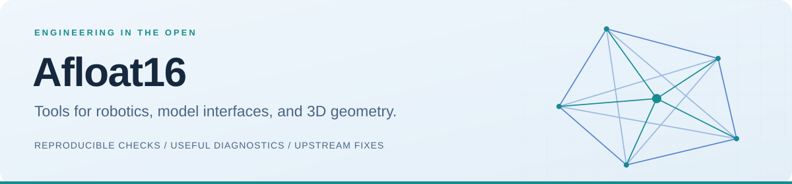

<picture>
  <source media="(prefers-color-scheme: dark)" srcset="assets/banner-dark.svg">
  
</picture>

**I build practical tools and contribute focused fixes to the libraries behind them.**

Python · TypeScript · Robotics data · Model interfaces · Computer vision

[Explore my projects](https://github.com/Afloat16/research-to-fix/blob/main/docs/PROJECTS.md) · [Merged contributions](#selected-merged-contributions) · [简体中文](README.zh-CN.md)

## Projects I build

| Geometry & robotics | Model interfaces & engineering |
|---|---|
| **[ReconTrail](https://github.com/Afloat16/recontrail)** CPU photogrammetry, capture checks, sparse geometry and portable offline reports. | **[Research to Fix](https://github.com/Afloat16/research-to-fix)** Prior solutions → local hypotheses → small fixes → reproducible validation. |
| **[Bag Timeline Audit](https://github.com/Afloat16/bag-timeline-audit)** Read-only ROS 2 SQLite/MCAP timestamp diagnostics. Pair with [TF Route Audit](https://github.com/Afloat16/tf-route-audit). | **[LLM Handshake](https://github.com/Afloat16/llm-handshake)** Bounded endpoint probes. Pair with [SSE Toolcall Audit](https://github.com/Afloat16/sse-toolcall-audit) and [Tooltrace Audit](https://github.com/Afloat16/tooltrace-audit). |
| **[Pose Convention Bridge](https://github.com/Afloat16/pose-convention-bridge)** Explicit camera-pose conversion. Pair with [COLMAP Model Audit](https://github.com/Afloat16/colmap-model-audit). | **[Jev MCP](https://github.com/Afloat16/jev-mcp)** Four conservative, read-only advisory tools through an unofficial TypeSafe Jev integration. |

Also: [Debate Direction](https://github.com/Afloat16/debate-direction) · [StewardCheck](https://github.com/Afloat16/ai-dev-steward/tree/main/tools/stewardcheck) · [Agent Action Notifier](https://github.com/Afloat16/agent-action-notifier).

**How I work:** isolate the symptom, understand the boundary, write a regression, and make the result inspectable. The [six domain utilities](https://github.com/Afloat16/research-to-fix/blob/main/docs/DEMAND_REVIEW.md#validation-for-this-release) have **67 local tests and 36 passing OS/Python CI combinations** at the recorded release. These are experimental diagnostics and conversion tools; each repository documents its limits.

## Selected merged contributions

Public upstream work: **41 merged PRs across 17 repositories**, checked on **14 October 2026**. The examples below are code fixes with accompanying regression coverage.

| Upstream project | What I contributed | Evidence |
|---|---|---|
| [DeepFace](https://github.com/serengil/deepface) · 23,549 ★ | Clip face boxes before array slicing; add crop-bound regressions. | [#1655](https://github.com/serengil/deepface/pull/1655) · merged |
| [Sentence Transformers](https://github.com/huggingface/sentence-transformers) · 19,171 ★ | Preserve ranking-loss gradients with weighted log-sigmoid. | [#4116](https://github.com/huggingface/sentence-transformers/pull/4116) · merged |
| [Kornia](https://github.com/kornia/kornia) · 11,424 ★ | Normalize small-root quartics to restore numerical threshold behavior. | [#5474](https://github.com/kornia/kornia/pull/5474) · merged |
| [Denoising Diffusion](https://github.com/lucidrains/denoising-diffusion-pytorch) · 10,706 ★ | Route external and self-conditioning consistently in 1D diffusion. | [#373](https://github.com/lucidrains/denoising-diffusion-pytorch/pull/373) · merged |
| [Atomic Agents](https://github.com/Eigenwise/atomic-agents) · 6,283 ★ | Keep prior chat history intact when loading fails. | [#292](https://github.com/Eigenwise/atomic-agents/pull/292) · merged |
| [Robotics Toolbox](https://github.com/petercorke/robotics-toolbox-python) · 3,536 ★ | Preserve Unicycle angular turn-rate units and limit semantics. | [#719](https://github.com/petercorke/robotics-toolbox-python/pull/719) · merged |
| [RSL-RL](https://github.com/leggedrobotics/rsl_rl) · 3,065 ★ | Resume the RND exploration schedule from PPO checkpoints. | [#240](https://github.com/leggedrobotics/rsl_rl/pull/240) · merged |
| [PyPose](https://github.com/pypose/pypose) · 1,614 ★ | Keep Cauchy objective values accurate for small residuals. | [#416](https://github.com/pypose/pypose/pull/416) · merged |

Stars belong to the upstream projects and are a dated snapshot. PR links show the exact changes, reviews and validation limits. [Contribution details](docs/CONTRIBUTIONS.md).

<strong>Open proposals and community work</strong>

| Project | Proposal | Status at the snapshot |
|---|---|---|
| [Segment Anything](https://github.com/facebookresearch/segment-anything/pull/868) | Prevent overflow in wide-mask stability scores. | Open; not merged |
| [PythonRobotics](https://github.com/AtsushiSakai/PythonRobotics/pull/1459) | Correct B-spline curvature and preserve finite-scale paths. | Draft; not merged |
| [Hugging Face Datasets](https://github.com/huggingface/datasets/pull/8771) | Honor NumPy dtype and copy behavior in ArrayXD adapters. | Draft; not merged |

I also share relevant tools in issue discussions and submit directory recommendations. [Community outreach](https://github.com/Afloat16/research-to-fix/blob/main/docs/OUTREACH.md) keeps those activities separate from merged software contributions.

---

[Project guide](https://github.com/Afloat16/research-to-fix/blob/main/docs/PROJECTS.md) · [Demand research](https://github.com/Afloat16/research-to-fix/blob/main/docs/DEMAND_REVIEW.md) · [Contribution record](docs/CONTRIBUTIONS.md)

