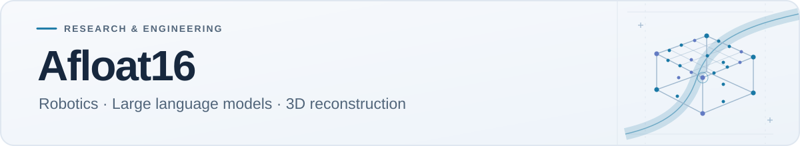

<picture>
  <source media="(prefers-color-scheme: dark)" srcset="https://raw.githubusercontent.com/Afloat16/Afloat16/main/assets/banner-2026-10-30-dark.svg?v=2">
  
</picture>

**我的研究主要围绕机器人、大模型和三维重建。**

我开发可复现的研究工具，开展原生软件保护实验，并为相关开源库贡献具体修复。

Python · TypeScript · C/C++ · 可复现实验 · 上游工程

[我的项目](#我的项目) · [开源贡献](#开源贡献) · [English](README.md)

## 开源贡献

截至 **2026-11-03 22:08（UTC+8）**，已核验我向 **28 个上游仓库**提交且已合并的 **117 个 PR**，涉及机器人、机器学习、几何与开发工具。

<picture>
  <source media="(prefers-color-scheme: dark)" srcset="https://raw.githubusercontent.com/Afloat16/Afloat16/main/assets/stats-2026-11-03-2208-dark.svg?v=2">
  
</picture>

### 近期精选已合并贡献

**6 个项目，每个项目一行**，精选体现程序分析、构建状态管理、数值正确性与数据处理能力的互补贡献。每个 PR 均已核实由 Afloat16 提交且被上游合并；项目按其最近一条精选贡献的合并时间排序，日期使用 Asia/Shanghai。[技术细节与范围](docs/CONTRIBUTIONS.md#selected-merges-by-project)。

| 最近精选合并 | 上游项目 · ★ | 代表性技术贡献 | PR / 合并 commit |
|---|---|---|---|
| 2026-11-03 | **[Craft Anything](https://github.com/storytold/craft-anything)** 6,553 ★ | 持久化跨运行重建进度并终止无变化重试；比较 WebAssembly 标签签名；按语义绑定恢复压缩 esbuild 模块依赖。 | [#557](https://github.com/storytold/craft-anything/pull/557) · [`48759fb`](https://github.com/storytold/craft-anything/commit/48759fb5fccde45405c2db29d162ac55edbc6562) [#441](https://github.com/storytold/craft-anything/pull/441) · [`fa4aae2`](https://github.com/storytold/craft-anything/commit/fa4aae2e79198ece843a876512172bfb10d902e3) [#438](https://github.com/storytold/craft-anything/pull/438) · [`89bcd06`](https://github.com/storytold/craft-anything/commit/89bcd061905de0f43e1dab161535fa4439ceb622) |
| 2026-11-02 | **[COLMAP](https://github.com/colmap/colmap)** 13,140 ★ | 通过数值稳健的向量归一化，使基准评估中的平移方向角误差不受重建尺度影响。 | [#4932](https://github.com/colmap/colmap/pull/4932) · [`27ffad4`](https://github.com/colmap/colmap/commit/27ffad4388ce5647df3ea9e547bf8e1ea155fbcd) |
| 2026-11-02 | **[Sentence Transformers](https://github.com/huggingface/sentence-transformers)** 19,251 ★ | 保留排序损失梯度，稳定 FP16 标量量化，并保持 LSTM 填充输出与 token 特征对齐。 | [#4116](https://github.com/huggingface/sentence-transformers/pull/4116) · [`abd266f`](https://github.com/huggingface/sentence-transformers/commit/abd266f29c7135e7ab9ccd3a41dfa74456b40c20) [#4113](https://github.com/huggingface/sentence-transformers/pull/4113) · [`847abf6`](https://github.com/huggingface/sentence-transformers/commit/847abf6e6f2187159d699c0001af2bb1f65e1f18) [#4301](https://github.com/huggingface/sentence-transformers/pull/4301) · [`26a0f49`](https://github.com/huggingface/sentence-transformers/commit/26a0f49fad7927dcc565a6ee9880730c2c65c64c) |
| 2026-11-01 | **[DeepFace](https://github.com/serengil/deepface)** 23,642 ★ | 统一 Milvus 与 DeepFace 的距离语义，完整读取图库，并保持空、单图和多图批次的返回结构。 | [#1634](https://github.com/serengil/deepface/pull/1634) · [`bf5ed73`](https://github.com/serengil/deepface/commit/bf5ed7339a0d430cbd214e4923ee6a694f808dec) [#1649](https://github.com/serengil/deepface/pull/1649) · [`5696e33`](https://github.com/serengil/deepface/commit/5696e3313ffdf6d51cd67f38a9da88ccd58ebb5e) [#1675](https://github.com/serengil/deepface/pull/1675) · [`8e565c0`](https://github.com/serengil/deepface/commit/8e565c050b821b8585e3c9527e419b0be5495fac) |
| 2026-10-27 | **[REA](https://github.com/morluto/rea)** 425,500 ★ | 补全 ZIP 短读并检测提前 EOF；在解析 JSON 前拒绝 HTTP CDP 发现响应中的无效 UTF-8。 | [#4414](https://github.com/morluto/rea/pull/4414) · [`82e4e03`](https://github.com/morluto/rea/commit/82e4e032dfe97b7912cebc2812e1e9fc41c1eb33) [#4524](https://github.com/morluto/rea/pull/4524) · [`095a51c`](https://github.com/morluto/rea/commit/095a51cf38d2a0dc58368f6c9482062d594f856b) |
| 2026-10-22 | **[LeRobot](https://github.com/huggingface/lerobot)** 28,660 ★ | 将 V-JEPA 2 已有的成对 RoPE 修正应用于 VLA-JEPA 训练期世界预测器。 | [#4835](https://github.com/huggingface/lerobot/pull/4835) · [`f9e9d73`](https://github.com/huggingface/lerobot/commit/f9e9d739ea7055b282ea1b165e8785412a674693) |

### 最近一次核实的贡献榜前 30

**18 个上游项目有前 30 位的已核验证据**。Craft Anything 保持 **#2†**，全时间贡献图中的提交数增至 **26**。每行标明排名核验日期，各组按最近核实的 star 降序排列。

| 项目 | 上游 ★ | 位置 · 核验日期¹ | 已合并 PR | 代表工作 |
|---|---:|---:|---:|---|
| **[DeepFace](https://github.com/serengil/deepface)** | 23,642 | [#7](https://api.github.com/repos/serengil/deepface/contributors?per_page=100&anon=false) 2026-11-03 | **[21](https://github.com/serengil/deepface/pulls?q=is%3Apr%20author%3AAfloat16%20is%3Amerged)** | 修正人脸裁剪边界、归一化与向量检索行为。 [#1655](https://github.com/serengil/deepface/pull/1655) · [#1658](https://github.com/serengil/deepface/pull/1658) |
| **[Sentence Transformers](https://github.com/huggingface/sentence-transformers)** | 19,251 | [#30](https://api.github.com/repos/huggingface/sentence-transformers/contributors?per_page=100&anon=false) 2026-11-03 | **[5](https://github.com/huggingface/sentence-transformers/pulls?q=is%3Apr%20author%3AAfloat16%20is%3Amerged)** | 修正排序梯度、编码器掩码与 float16 量化。 [#4127](https://github.com/huggingface/sentence-transformers/pull/4127) |
| **[Denoising Diffusion](https://github.com/lucidrains/denoising-diffusion-pytorch)** | 10,724 | [#9](https://api.github.com/repos/lucidrains/denoising-diffusion-pytorch/contributors?per_page=100&anon=false) 2026-11-03 | **[1](https://github.com/lucidrains/denoising-diffusion-pytorch/pulls?q=is%3Apr%20author%3AAfloat16%20is%3Amerged)** | 保留一维扩散中的外部条件与自条件。 [#373](https://github.com/lucidrains/denoising-diffusion-pytorch/pull/373) |
| **[Craft Anything](https://github.com/storytold/craft-anything)** | 6,553 | [#2†](https://github.com/storytold/craft-anything/graphs/contributors?all=1) 2026-11-03 | **[20](https://github.com/storytold/craft-anything/pulls?q=is%3Apr%20author%3AAfloat16%20is%3Amerged)** | 持久化跨运行重建进度并终止无变化重试；比较 WebAssembly 标签签名；按语义绑定恢复压缩 esbuild 模块依赖。 [#557](https://github.com/storytold/craft-anything/pull/557) · [#441](https://github.com/storytold/craft-anything/pull/441) · [#438](https://github.com/storytold/craft-anything/pull/438) |
| **[PyTorch Metric Learning](https://github.com/KevinMusgrave/pytorch-metric-learning)** | 6,343 | [#9](https://api.github.com/repos/KevinMusgrave/pytorch-metric-learning/contributors?per_page=100&anon=false) 2026-11-03 | **[3](https://github.com/KevinMusgrave/pytorch-metric-learning/pulls?q=is%3Apr%20author%3AAfloat16%20is%3Amerged)** | NT-Xent 损失与梯度数值稳定性，以及 HistogramLoss、PNP 的独立回归验证。 [#758](https://github.com/KevinMusgrave/pytorch-metric-learning/pull/758) · [#759](https://github.com/KevinMusgrave/pytorch-metric-learning/pull/759) |
| **[Atomic Agents](https://github.com/Eigenwise/atomic-agents)** | 6,316 | [#28](https://api.github.com/repos/Eigenwise/atomic-agents/contributors?per_page=100&anon=false) 2026-11-03 | **[1](https://github.com/Eigenwise/atomic-agents/pulls?q=is%3Apr%20author%3AAfloat16%20is%3Amerged)** | 加载失败时保留已有对话历史。 [#292](https://github.com/Eigenwise/atomic-agents/pull/292) |
| **[Robotics Toolbox](https://github.com/petercorke/robotics-toolbox-python)** | 3,560 | [#6](https://api.github.com/repos/petercorke/robotics-toolbox-python/contributors?per_page=100&anon=false) 2026-11-03 | **[11](https://github.com/petercorke/robotics-toolbox-python/pulls?q=is%3Apr%20author%3AAfloat16%20is%3Amerged)** | 修正运动学、动力学、逆运动学与 URDF 处理。 [#801](https://github.com/petercorke/robotics-toolbox-python/pull/801) |
| **[RSL-RL](https://github.com/leggedrobotics/rsl_rl)** | 3,116 | [#5](https://api.github.com/repos/leggedrobotics/rsl_rl/contributors?per_page=100&anon=false) 2026-11-03 | **[3](https://github.com/leggedrobotics/rsl_rl/pulls?q=is%3Apr%20author%3AAfloat16%20is%3Amerged)** | 恢复 RND 调度进度，保持奖励历史独立并保留 rollout 尾批样本。 [#240](https://github.com/leggedrobotics/rsl_rl/pull/240) · [#244](https://github.com/leggedrobotics/rsl_rl/pull/244) |
| **[PyPose](https://github.com/pypose/pypose)** | 1,620 | [#15](https://api.github.com/repos/pypose/pypose/contributors?per_page=100&anon=false) 2026-11-03 | **[4](https://github.com/pypose/pypose/pulls?q=is%3Apr%20author%3AAfloat16%20is%3Amerged)** | 最小二乘刚体配准、鲁棒核稳定性与相机参数广播。 [#437](https://github.com/pypose/pypose/pull/437) |
| **[RL Games](https://github.com/Denys88/rl_games)** | 1,409 | [#6](https://api.github.com/repos/Denys88/rl_games/contributors?per_page=100&anon=false) 2026-11-03 | **[4](https://github.com/Denys88/rl_games/pulls?q=is%3Apr%20author%3AAfloat16%20is%3Amerged)** | 回放批次超出容量时保留最新转移样本。 [#384](https://github.com/Denys88/rl_games/pull/384) |
| **[Geoopt](https://github.com/geoopt/geoopt)** | 1,103 | [#3](https://api.github.com/repos/geoopt/geoopt/contributors?per_page=100&anon=false) 2026-11-03 | **[10](docs/CONTRIBUTIONS.md#complete-merged-pr-index)** | 流形约束、梯度投影、优化器状态与几何计算稳定性。 [#267](https://github.com/geoopt/geoopt/pull/267) · [#254](https://github.com/geoopt/geoopt/pull/254) |
| **[skrl](https://github.com/Toni-SM/skrl)** | 1,102 | [#3](https://api.github.com/repos/Toni-SM/skrl/contributors?per_page=100&anon=false) 2026-11-03 | **[3](https://github.com/Toni-SM/skrl/pulls?q=is%3Apr%20author%3AAfloat16%20is%3Amerged)** | 修正高斯策略计算，保持跨后端探索行为一致。 [#475](https://github.com/Toni-SM/skrl/pull/475) |
| **[pytransform3d](https://github.com/dfki-ric/pytransform3d)** | 707 | [#15](https://api.github.com/repos/dfki-ric/pytransform3d/contributors?per_page=100&anon=false) 2026-11-03 | **[2](https://github.com/dfki-ric/pytransform3d/pulls?q=is%3Apr%20author%3AAfloat16%20is%3Amerged)** | 稳定李群雅可比计算并修正螺旋轴的平移处理。 [#389](https://github.com/dfki-ric/pytransform3d/pull/389) |
| **[RoMa](https://github.com/naver/roma)** | 647 | [#2](https://api.github.com/repos/naver/roma/contributors?per_page=100&anon=false) 2026-11-03 | **[4](https://github.com/naver/roma/pulls?q=is%3Apr%20author%3AAfloat16%20is%3Amerged)** | 四元数广播、仿射变换张量形状与可复现采样。 [#33](https://github.com/naver/roma/pull/33) |
| **[Rectified Flow](https://github.com/lucidrains/rectified-flow-pytorch)** | 490 | [#3](https://api.github.com/repos/lucidrains/rectified-flow-pytorch/contributors?per_page=100&anon=false) 2026-11-03 | **[1](https://github.com/lucidrains/rectified-flow-pytorch/pulls?q=is%3Apr%20author%3AAfloat16%20is%3Amerged)** | 使 NanoFlow 逆变换在归一化流坐标中计算。 [#50](https://github.com/lucidrains/rectified-flow-pytorch/pull/50) |
| **[KinPy](https://github.com/neka-nat/kinpy)** | 181 | [#2](https://api.github.com/repos/neka-nat/kinpy/contributors?per_page=100&anon=false) 2026-11-03 | **[3](https://github.com/neka-nat/kinpy/pulls?q=is%3Apr%20author%3AAfloat16%20is%3Amerged)** | 修正世界坐标系雅可比中的轴方向与连杆偏移。 [#29](https://github.com/neka-nat/kinpy/pull/29) |
| **[Elements](https://github.com/danijar/elements)** | 73 | [#3](https://api.github.com/repos/danijar/elements/contributors?per_page=100&anon=false) 2026-11-03 | **[2](https://github.com/danijar/elements/pulls?q=is%3Apr%20author%3AAfloat16%20is%3Amerged)** | 保留隐藏文件名，修正本地路径操作。 [#19](https://github.com/danijar/elements/pull/19) |
| **[qpmpc](https://github.com/stephane-caron/qpmpc)** | 56 | [#2](https://api.github.com/repos/stephane-caron/qpmpc/contributors?per_page=100&anon=false) 2026-11-03 | **[3](https://github.com/stephane-caron/qpmpc/pulls?q=is%3Apr%20author%3AAfloat16%20is%3Amerged)** | 保持可选约束的缺省状态，修正目标缩放与摆模型离散化。 [#15](https://github.com/stephane-caron/qpmpc/pull/15) · [#17](https://github.com/stephane-caron/qpmpc/pull/17) |

### 更多已合并的上游贡献

| 项目 | 上游 ★ | 位置 · 核验日期¹ | 已合并 PR | 代表工作 |
|---|---:|---:|---:|---|
| **[REA](https://github.com/morluto/rea)** | 425,500 | [#77](https://api.github.com/repos/morluto/rea/contributors?per_page=100&anon=false&page=1) 2026-11-03 | **[3](https://github.com/morluto/rea/pulls?q=is%3Apr%20author%3AAfloat16%20is%3Amerged)** | 安装客户端去重、补全 ZIP 读取并校验 CDP 响应编码。 [#4414](https://github.com/morluto/rea/pull/4414) · [#4524](https://github.com/morluto/rea/pull/4524) |
| **[LeRobot](https://github.com/huggingface/lerobot)** | 28,660 | [#228](https://api.github.com/repos/huggingface/lerobot/contributors?per_page=100&anon=false&page=3) 2026-11-03 | **[1](https://github.com/huggingface/lerobot/pulls?q=is%3Apr%20author%3AAfloat16%20is%3Amerged)** | 修正 VLA-JEPA 训练期预测器的成对 RoPE 频率。 [#4835](https://github.com/huggingface/lerobot/pull/4835) |
| **[Haystack](https://github.com/deepset-ai/haystack)** | 26,920 | [#365](https://api.github.com/repos/deepset-ai/haystack/contributors?per_page=100&anon=false&page=4) 2026-11-03 | **[1](https://github.com/deepset-ai/haystack/pulls?q=is%3Apr%20author%3AAfloat16%20is%3Amerged)** | 隔离恢复执行计数，保持流水线快照可复用。 [#13076](https://github.com/deepset-ai/haystack/pull/13076) |
| **[Recommenders](https://github.com/recommenders-team/recommenders)** | 21,975 | [#49](https://api.github.com/repos/recommenders-team/recommenders/contributors?per_page=100&anon=false&page=1) 2026-11-03 | **[2](https://github.com/recommenders-team/recommenders/pulls?q=is%3Apr%20author%3AAfloat16%20is%3Amerged)** | 保留自定义列名，拒绝无效的 top-k 参数。 [#2389](https://github.com/recommenders-team/recommenders/pull/2389) |
| **[COLMAP](https://github.com/colmap/colmap)** | 13,140 | [#55](https://api.github.com/repos/colmap/colmap/contributors?per_page=100&anon=false&page=1) 2026-11-03 | **[2](https://github.com/colmap/colmap/pulls?q=is%3Apr%20author%3AAfloat16%20is%3Amerged)** | 平移方向角误差的尺度不变性与基准运行路径解析。 [#4932](https://github.com/colmap/colmap/pull/4932) · [#4931](https://github.com/colmap/colmap/pull/4931) |
| **[Kornia](https://github.com/kornia/kornia)** | 12,289 | [#134](https://api.github.com/repos/kornia/kornia/contributors?per_page=100&anon=false&page=2) 2026-11-03 | **[3](https://github.com/kornia/kornia/pulls?q=is%3Apr%20author%3AAfloat16%20is%3Amerged)** | 保持几何计算梯度有限，稳定小根四次方程求解。 [#5517](https://github.com/kornia/kornia/pull/5517) |
| **[TileLang](https://github.com/tile-ai/tilelang)** | 8,896 | [#210](https://api.github.com/repos/tile-ai/tilelang/contributors?per_page=100&anon=false&page=3) 2026-11-03 | **[1](https://github.com/tile-ai/tilelang/pulls?q=is%3Apr%20author%3AAfloat16%20is%3Amerged)** | 让性能测量遵循当前 CUDA 设备选择。 [#3357](https://github.com/tile-ai/tilelang/pull/3357) |
| **[MLxtend](https://github.com/rasbt/mlxtend)** | 5,190 | [#95](https://api.github.com/repos/rasbt/mlxtend/contributors?per_page=100&anon=false&page=1) 2026-11-03 | **[1](https://github.com/rasbt/mlxtend/pulls?q=is%3Apr%20author%3AAfloat16%20is%3Amerged)** | 修正提取出的表情符号与末尾单词的粘连。 [#1207](https://github.com/rasbt/mlxtend/pull/1207) |
| **[Trimesh](https://github.com/mikedh/trimesh)** | 3,715 | — | **[1](https://github.com/mikedh/trimesh/pulls?q=is%3Apr%20author%3AAfloat16%20is%3Amerged)** | 修正非均匀权重的 Procrustes 旋转，保留等权重拟合；合并至 `release/angles`。 [#2618](https://github.com/mikedh/trimesh/pull/2618) |
| **[Geomstats](https://github.com/geomstats/geomstats)** | 1,528 | [#84](https://api.github.com/repos/geomstats/geomstats/contributors?per_page=100&anon=false&page=1) 2026-11-03 | **[1](https://github.com/geomstats/geomstats/pulls?q=is%3Apr%20author%3AAfloat16%20is%3Amerged)** | 将乘积度量的平行移动逐因子传递。 [#2131](https://github.com/geomstats/geomstats/pull/2131) |

¹ 除 † 外，排名采用 GitHub 按 commit 排序的 REST 贡献者列表，包含机器人、排除匿名账户，同 commit 数保留 API 返回顺序；27 个数值排名沿用 11 月 3 日 21:43 快照。† Craft Anything 使用 **main 分支、排除 merge commit 的全时间贡献图**，21:57 重新核实为 **#2 / 26 commits**；独立 REST 结果为 **#3 / 20**。`—` 表示未获得数值排名。本次更新六个精选项目的 star 与 Craft 采纳记录，其他数据保留各自核验时间。[完整 PR、统计口径与数据](docs/CONTRIBUTIONS.md)。

### 由维护者整合进入默认分支的代码

**[TD-MPC2](https://github.com/nicklashansen/tdmpc2)**（995 ★，贡献榜 [#3](https://api.github.com/repos/nicklashansen/tdmpc2/contributors?per_page=100&anon=false)）：修复模型转换时 target-Q 历史和评估模式的保留。[#98](https://github.com/nicklashansen/tdmpc2/pull/98) 的实现已[保留 Afloat16 作者身份 cherry-pick](https://github.com/nicklashansen/tdmpc2/commit/332f19e4aba4bffe2dc736f45ea7f7bdc585903a)；原 PR 关闭但未直接合并。连同上述仓库，共有 **29 个上游项目采纳了我的代码**。

Robotics Toolbox 通过 [#883](https://github.com/petercorke/robotics-toolbox-python/pull/883) 整合 [#735](https://github.com/petercorke/robotics-toolbox-python/pull/735) 的圆周粒子朝向工作，并通过 [#805](https://github.com/petercorke/robotics-toolbox-python/pull/805) 整合 [#736](https://github.com/petercorke/robotics-toolbox-python/pull/736) 的轨迹改动，保留共同作者身份。这些记录与我提交且已合并的 117 个 PR 分开统计。[详情](docs/CONTRIBUTIONS.md#other-accepted-work)。

**[Craft Anything](https://github.com/storytold/craft-anything)** 还通过 **6 次维护者整合**采纳了 **32 个原始作者 PR** 中的工作：[#645](https://github.com/storytold/craft-anything/pull/645) · [#648](https://github.com/storytold/craft-anything/pull/648) · [#649](https://github.com/storytold/craft-anything/pull/649) · [#652](https://github.com/storytold/craft-anything/pull/652) · [#653](https://github.com/storytold/craft-anything/pull/653) · [#656](https://github.com/storytold/craft-anything/pull/656)。这 6 个默认分支 commit 均保留我的共同署名，采纳记录与 **117 个直接合并的作者 PR** 分开统计。[证据](docs/CONTRIBUTIONS.md#other-accepted-work)。

## 我的项目

**[Anti-REA Forge](https://github.com/Afloat16/anti-rea-forge)** · **MIT · 0.4.0 Alpha** 
原生发布加固：CMake 集成、PE/ELF 发布检查、受保护的 C++ 敏感内存与一次性请求授权。包含可运行示例、跨平台 CI 和研究驱动的设计。[项目故事](https://github.com/Afloat16/anti-rea-forge/blob/main/docs/community/PROJECT_STORY.md) · [参与讨论](https://github.com/Afloat16/anti-rea-forge/issues/1)。

**[ModelDock](https://github.com/Afloat16/modeldock)** · **[v0.2.0](https://github.com/Afloat16/modeldock/releases/tag/v0.2.0)** 
本地 3D/CAD 预览，支持超过 5 GiB 的二进制 PLY/STL 有界采样、多模型对齐与参考评价。[验证记录](https://github.com/Afloat16/modeldock/blob/main/docs/validation.md)。

### 机器人 · 大模型 · 三维重建

| 机器人 | 大模型 | 三维重建 |
|---|---|---|
| **[Bag Timeline Audit](https://github.com/Afloat16/bag-timeline-audit)** 只读 ROS 2 SQLite/MCAP 时间戳诊断。 | **[LLM Handshake](https://github.com/Afloat16/llm-handshake)** 有界 OpenAI 兼容端点探测与报告对比。 | **[ReconTrail](https://github.com/Afloat16/recontrail)** CPU 摄影测量、稀疏重建与离线报告。 |
| **[TF Route Audit](https://github.com/Afloat16/tf-route-audit)** 导出 TF 的拓扑/时间窗口检查与原生 URDF 拓扑检查。 | **[SSE Toolcall Audit](https://github.com/Afloat16/sse-toolcall-audit)** 和 **[Tooltrace Audit](https://github.com/Afloat16/tooltrace-audit)** 对已保存的流式响应与工具执行轨迹进行诊断。 | **[Pose Convention Bridge](https://github.com/Afloat16/pose-convention-bridge)** 和 **[COLMAP Model Audit](https://github.com/Afloat16/colmap-model-audit)** 显式位姿约定转换与文本模型预检查。 |

**[Jev MCP](https://github.com/Afloat16/jev-mcp)** · [v0.5.0](https://github.com/Afloat16/jev-mcp/releases/tag/v0.5.0)：提供有界概率建议、路由与风险信号的 TypeScript MCP 服务，配有多客户端安装器。

研究与工程工作流：[Research to Fix](https://github.com/Afloat16/research-to-fix) · [Debate Direction](https://github.com/Afloat16/debate-direction) · [StewardCheck](https://github.com/Afloat16/ai-dev-steward/tree/main/tools/stewardcheck) · [Agent Action Notifier](https://github.com/Afloat16/agent-action-notifier)。

**我的工作方式：**隔离症状、明确边界、补充回归测试，并让结果可检查。[六个领域工具](https://github.com/Afloat16/research-to-fix/blob/main/docs/DEMAND_REVIEW.md#validation-for-this-release)在记录的发布版本中有 **67 项本地测试、36 组通过的 OS/Python CI 组合**。这些是实验性诊断与转换工具，各仓库均说明适用范围。

<b>全部 15 个项目：Stars 与默认分支 commits</b>

截至 **2026-11-03 21:43（UTC+8）**，按 stars 降序，同星按仓库 commit 数降序排列。这里的 commits 是各仓库默认分支可达的历史提交数（含 merge commits），不是个人作者提交数。完整来源与版本见[项目记录](docs/PROJECTS.md)。

| 项目 | ★ | 默认分支 commits | 主要语言 |
|---|---:|---:|---|
| [Anti-REA Forge](https://github.com/Afloat16/anti-rea-forge) | [3](https://github.com/Afloat16/anti-rea-forge/stargazers) | [12](https://github.com/Afloat16/anti-rea-forge/commits/main/) | Python |
| [Jev MCP](https://github.com/Afloat16/jev-mcp) | [1](https://github.com/Afloat16/jev-mcp/stargazers) | [49](https://github.com/Afloat16/jev-mcp/commits/main/) | TypeScript |
| [StewardCheck](https://github.com/Afloat16/ai-dev-steward) | [1](https://github.com/Afloat16/ai-dev-steward/stargazers) | [11](https://github.com/Afloat16/ai-dev-steward/commits/main/) | Python |
| [Debate Direction](https://github.com/Afloat16/debate-direction) | [1](https://github.com/Afloat16/debate-direction/stargazers) | [8](https://github.com/Afloat16/debate-direction/commits/main/) | Python |
| [LLM Handshake](https://github.com/Afloat16/llm-handshake) | [1](https://github.com/Afloat16/llm-handshake/stargazers) | [6](https://github.com/Afloat16/llm-handshake/commits/main/) | Python |
| [ModelDock](https://github.com/Afloat16/modeldock) | [1](https://github.com/Afloat16/modeldock/stargazers) | [6](https://github.com/Afloat16/modeldock/commits/main/) | TypeScript |
| [Bag Timeline Audit](https://github.com/Afloat16/bag-timeline-audit) | [1](https://github.com/Afloat16/bag-timeline-audit/stargazers) | [5](https://github.com/Afloat16/bag-timeline-audit/commits/main/) | Python |
| [ReconTrail](https://github.com/Afloat16/recontrail) | [1](https://github.com/Afloat16/recontrail/stargazers) | [5](https://github.com/Afloat16/recontrail/commits/main/) | Python |
| [Research to Fix](https://github.com/Afloat16/research-to-fix) | [1](https://github.com/Afloat16/research-to-fix/stargazers) | [5](https://github.com/Afloat16/research-to-fix/commits/main/) | Python |
| [SSE Toolcall Audit](https://github.com/Afloat16/sse-toolcall-audit) | [1](https://github.com/Afloat16/sse-toolcall-audit/stargazers) | [5](https://github.com/Afloat16/sse-toolcall-audit/commits/main/) | Python |
| [TF Route Audit](https://github.com/Afloat16/tf-route-audit) | [1](https://github.com/Afloat16/tf-route-audit/stargazers) | [5](https://github.com/Afloat16/tf-route-audit/commits/main/) | Python |
| [Tooltrace Audit](https://github.com/Afloat16/tooltrace-audit) | [1](https://github.com/Afloat16/tooltrace-audit/stargazers) | [5](https://github.com/Afloat16/tooltrace-audit/commits/main/) | Python |
| [Agent Action Notifier](https://github.com/Afloat16/agent-action-notifier) | [0](https://github.com/Afloat16/agent-action-notifier/stargazers) | [6](https://github.com/Afloat16/agent-action-notifier/commits/main/) | Python |
| [COLMAP Model Audit](https://github.com/Afloat16/colmap-model-audit) | [0](https://github.com/Afloat16/colmap-model-audit/stargazers) | [4](https://github.com/Afloat16/colmap-model-audit/commits/main/) | Python |
| [Pose Convention Bridge](https://github.com/Afloat16/pose-convention-bridge) | [0](https://github.com/Afloat16/pose-convention-bridge/stargazers) | [4](https://github.com/Afloat16/pose-convention-bridge/commits/main/) | Python |

---

[项目指南](https://github.com/Afloat16/research-to-fix/blob/main/docs/PROJECTS.zh-CN.md) · [需求研究](https://github.com/Afloat16/research-to-fix/blob/main/docs/DEMAND_REVIEW.md) · [项目数据](docs/PROJECTS.md) · [贡献记录](docs/CONTRIBUTIONS.md)

